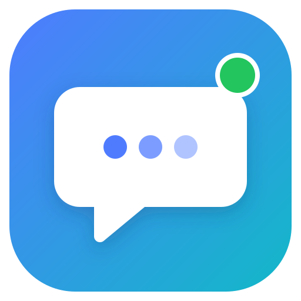

<div align="center">
  

  <h1>在线客服聊天系统</h1>

  <p>基于 <b>Cloudflare Workers + D1</b> 的轻量在线客服 · 访客免登录 · 客服有工作台 · 免费额度即可跑</p>

  <p>
    <a href="https://github.com/你的GitHub用户名/cf-kefu-chat/stargazers"></a>
    
    
    
    
    
  </p>

  <p>
    <b>零服务器</b> · <b>零数据库费用</b> · <b>一条网址同时是访客端和客服端</b>
  </p>

  <p>
    <a href="./Cloudflare部署完整教程.md"><b>📘 部署教程</b></a> ·
    <a href="#功能">功能</a> ·
    <a href="#部署">部署</a> ·
    <a href="#常见问题">常见问题</a>
  </p>
</div>

---

> ⭐ **如果这个项目帮到你，点个 Star 支持一下。** 不用下载压缩包，Fork 仓库就能部署，详细步骤见 [Cloudflare 部署完整教程（Fork 版）](./Cloudflare部署完整教程.md)。

> ⚠️ **项目声明**：本项目为开源的在线客服系统，仅供学习、研究与合法业务使用。请遵守所在地法律法规；项目作者及贡献者不对使用本项目开展的业务内容或服务承担责任。遇到问题请通过 GitHub 提交 issue，请勿将开源项目用于违法违规用途。

## 📸 界面预览

| 访客端 `/` | 客服工作台 `/agent` |
| :---: | :---: |
|  |  |

> 完整截图（含设置面板、备注弹窗、手机端）在 `预览/` 目录。


| 需求 | 现在的实现 |
| --- | --- |
| 前台打开域名就能对话 | `/` 直接进聊天，不用注册；身份存在浏览器本地，刷新不丢记录 |
| 后台输入口令登录 | `/agent` 输入「客服名称 + 口令」进入；**第一次登录时输入的口令，自动成为系统口令** |
| 互相实时聊天 | 双方 2 秒内自动同步（页面在后台时降到 8 秒，回到前台立即补拉） |
| 文字 / 表情 / 图片 | 输入框右侧有表情面板；图片选完自动压缩再上传 |
| 撤回 | 120 秒内可撤回，只有发送方能撤，双方都显示"撤回了一条消息" |
| 删除 | 只对自己隐藏，对方那边不受影响 |
| 备注顾客 | 会话右上角铅笔按钮，备注只在自己工作台显示 |
| 修改客服名称 | 工作台「设置」里改，对方消息上方显示完整名称（不再只显示首字）；名称下方还可上传客服头像，不上传时用首字圆框 |
| 自动欢迎语 | 「设置」里可开关、改内容、改署名；新访客进来自动发一条 |
| 已读 / 未读 | 自己发的消息下方显示「已读 / 未读」；会话列表有未读数字角标 |
| 空间用量 | 「设置」里直接显示已用多少 / 共 5GB / 剩余多少、还能发多少条，可设自动清理 |
| 访客 IP / 归属地 / 来源 / 设备 | 自动记录（Cloudflare 边缘数据，免费），会话列表和会话顶部都能看到；设备形如「iPhone · 微信」「Windows · Edge」 |
| 拉黑客户 | 会话顶部「拉黑」按钮，拉黑后对方发不了消息、不能留联系方式，记录都保留；再点一次可撤销 |
| 关键词自动回复 | 在线、离线两套规则，预置好常用词；一行一条 `关键词=回复`，后台随时改 |
| 消息提示音 | 内置"叮—咚"三音（约 1 秒，比原来更长更响），**响铃次数可设 1～5 次**，可试听，**可上传自己的提示音**（MP3/M4A/OGG/WAV，≤400KB），可一键恢复默认；**不打开那个会话也会响**，同时弹「新消息 · 某某」提示 |
| 访客留联系方式 | 访客端「留联系方式」按钮，可填手机号 / 微信 / QQ / 邮箱，后台会话顶部显示 |
| 消息推送 | **5 个渠道可任选、可同时开**：Server酱、PushPlus（微信）、钉钉群机器人、企业微信群机器人、Bark（iPhone）；同一会话 5 秒内最多一条 |
| 删除会话 | 会话顶部「删除会话」，二次确认后永久删除该访客的会话 + 全部消息 + 图片，释放 D1 空间（删前建议先导出） |
| 导出聊天记录 | 会话标题栏「导出」，下载 CSV，Excel 手机都能直接打开 |
| 对话结束语 | 会话顶部「结束对话」：自动发一条可自定义的收尾消息并标记结束；访客再发消息自动重新开始；可设「沉默 N 分钟自动结束」 |
| 同一 IP 不再新起会话 | 同一 IP 再次进入接着原会话聊，欢迎语不重发；可在设置里开关、设合并窗口，支持一键「合并历史重复会话」 |
| 嵌到自己网站 | 包里带 `embed.js`，一行配置出右下角悬浮客服；也可用 iframe 直接嵌 |

## ✨ 功能

**访客端**
- 打开网址直接聊天，**不需要注册登录**，身份存在浏览器本地，刷新不丢记录
- 文字、表情、图片（上传前自动压缩）
- 撤回（默认 120 秒内，仅发送方可撤回，双方都看到撤回提示）
- 删除（只对自己隐藏，不影响对方）
- 自己发出的消息显示 **已读 / 未读**
- 图片点击全屏查看，消息上方显示完整客服名称和头像
- 「留联系方式」按钮：手机号 / 微信 / QQ / 邮箱，可不填
- 命中关键词自动收到回复（带「自动回复」标签）

**客服工作台**
- 口令登录，首次登录输入的口令即成为系统口令，可自定义客服名称
- 会话列表按最新消息排序，带**未读角标**、对方**在线小绿点**、最后一条消息预览
- 备注顾客（仅自己可见）、**导出聊天记录 CSV**
- **对话结束语**：一键「结束对话」自动发出收尾消息并标记结束，访客再发消息自动重新开始；也能设置沉默 N 分钟自动结束
- **同一 IP 复用会话**：清缓存 / 换浏览器再进来接着原会话聊，不重复发欢迎语；支持一键合并历史重复会话
- 设置面板：店铺名称、客服名称、头像、自动欢迎语、修改口令
- 设置面板：**接待状态（在线 / 离线）**、新消息提示音、两套关键词自动回复、微信推送（Server酱）
- 设置面板：**存储用量面板 + 自动清理 + 立即清理**
- 会话信息显示**访客 IP / 归属地 / 来源网站 / 联系方式**
- 窄屏自动切换「会话列表 → 聊天」单栏布局

**其他**
- `public/embed.js`：一行配置给任意网站加右下角悬浮客服按钮（也支持 iframe 直接嵌）
- 图片默认存 D1；开通 R2 后自动优先走 R2，单张上限放宽到 5MB

## 二、需要准备什么

1. 一个 Cloudflare 账号（免费注册，不要信用卡）
2. 一个 GitHub 账号（免费）
3. 电脑浏览器（Chrome / Edge 都行）
4. 没有GitHub的话，这里获取 https://shop.xqdj.site/product/github-du-xiang-cheng-pin-zhang-hao
5. 推荐开通R2，不开通也能部署，这里获取 https://shop.xqdj.site/product/cloudflare-r2-cun-chu-tong-kai-tong

D1 数据库、Workers 都在免费额度里，不用买服务器、不用买数据库。

---

## 三、六步部署（Fork + Cloudflare，全程网页操作）

先去项目仓库点一下 **Star ⭐**，再点右上角 **Fork**，把仓库复制到你自己账号下。

### 第 1 步：在 Cloudflare 建一个 D1 数据库

1. 登录 Cloudflare → 左侧菜单找到 **存储和数据库 / Storage & Databases** → **D1 SQL Database**
2. 点 **Create database / 创建数据库**，名称填 `cf_kefu`（必须一致，也可以改 `wrangler.toml` 里的名字）
3. 创建好进入数据库详情页，复制页面上的 **Database ID**（一串像 `a1b2c3d4-1234-...` 的字符），先记在记事本里

> 建库时**不用**建表、不用执行任何 SQL —— 程序第一次运行会自己把表建好。

### 第 2 步：开通 R2 并创建存储桶（推荐）

R2 用来存聊天图片，开了以后图片不占 D1 空间，能发更大的图；不开也能用，图片会存进 D1（单张约 700KB 以内）。

1. Cloudflare 左侧 **R2 Object Storage**（或 Storage & databases → R2）→ 点 **Enable R2 / 开通 R2**，选 **Free / 免费套餐（$0/月）**
2. 部分账号会要求添加付款方式（信用卡 / PayPal），只是账号验证，**不超额不会扣费**；不想绑卡就跳过这一步，后面 `wrangler.toml` 里 R2 三行保持注释
3. 点 **Create bucket / 创建存储桶**，名称填 `cf-kefu-files`（必须和 `wrangler.toml` 的 `bucket_name` 完全一致，建完不能改名）
4. Location 选 **Automatic**，点 **Create bucket**

> **不用**开启 Public access（公开访问），也**不用**创建 R2 API Token：本项目通过 Worker 绑定读取图片，桶保持私有即可。

### 第 3 步：改你 fork 里的 `wrangler.toml`

1. 打开你自己 fork 的仓库 → 点开根目录 `wrangler.toml` → 点铅笔图标编辑
2. 找到这一行：

```
database_id = "REPLACE_WITH_YOUR_D1_DATABASE_ID"
```

把引号里的内容换成第 1 步复制的 **Database ID**，例如：

```
database_id = "a1b2c3d4-1234-5678-9999-abcdefabcdef"
```

3. 如果第 2 步建了 R2 桶，把下面三行前面的 `#` 去掉：

```toml
[[r2_buckets]]
binding = "BUCKET"
bucket_name = "cf-kefu-files"
```

4. 页面下方 **Commit changes** 保存

### 第 5 步：让 Cloudflare 自动部署你的 fork

1. Cloudflare 控制台 → **Workers & Pages** → **Create / 创建**
2. 选 **Workers** → **Import a repository / 导入仓库**（第一次用会让你授权 GitHub，点同意）
3. 选中**你自己名下的** fork（列表里显示 `你的用户名/cf-kefu-chat`，别选成作者的原始仓库），分支选 `main`
4. 构建命令填：`npm install`
   部署命令填：`npx wrangler deploy`
   （如果页面已有默认值，留着默认的也行，只要最终是 `npx wrangler deploy`）
5. 点 **Save and Deploy / 保存并部署**，等 1～2 分钟

部署成功后页面会给你一个网址，形如：

```
https://cf-kefu-chat.你的子域.workers.dev
```

- 访客端 = 这个网址本身
- 客服工作台 = 网址后面加 `/agent`

以后你在 fork 里改任何文件（包括改 `wrangler.toml` 的配置），Cloudflare 都会自动重新部署，不需要手动操作。
作者更新后，在 fork 首页点 **Sync fork** 即可；同步时注意保留你自己的 `database_id` 和 `bucket_name`。

### 第 6 步：第一次登录，把口令定下来

1. 手机或电脑打开 `https://xxx.workers.dev/agent`
2. **客服名称**：填你想显示的名字（例如 `小旗`）
3. **客服口令**：随便设一个 ≥ 4 位的口令（**这一次输入的口令就会成为系统口令**，之后所有客服都用它登录）
4. 点「进入工作台」

进去后点左下角 **设置**，可以马上改：店铺名称、我的客服名称、客服头像、欢迎语开关/内容/署名、口令、接待状态（在线/离线）、提示音、联系方式收集、两套关键词自动回复、微信推送、自动清理。

然后把这个访客端网址发给顾客，顾客点开就能聊天，你在工作台就能收到。

> 数据表由 Worker 首次请求自动创建，不需要执行 migrations。
> 逐步图文（含 R2 开通问答、10 项自检、报错排查）：**[Cloudflare 部署完整教程（Fork 版）](./Cloudflare部署完整教程.md)**

## 🗂 目录结构

```
cf-kefu-chat/
├── src/index.js                   # Worker：API + 静态资源路由 + 自动建表
├── public/
│   ├── index.html                 # 访客端
│   ├── agent.html                 # 客服工作台（登录/设置/备注/结束对话）
│   ├── embed.js                   # 悬浮客服按钮
│   └── assets/                    # 共用样式与聊天核心
├── migrations/                    # 建表 SQL（仅参考，运行时会自动建表）
├── wrangler.toml                  # Cloudflare 配置
├── docs/                          # 预览图与 Logo
└── 预览/                          # 更多截图
```

## ⚙️ 配置

`wrangler.toml` 的 `[vars]` 只是**初始默认值**，部署后可在「工作台 → 设置」里改并立即生效：

| 变量 | 说明 |
| --- | --- |
| `SHOP_NAME` | 店铺名称 |
| `WELCOME_ENABLED` / `WELCOME_TEXT` | 自动欢迎语开关与内容 |
| `RECALL_WINDOW_SEC` | 撤回时限（秒） |
| `AUTO_DELETE_DAYS` | 消息自动清理天数，0 为不清理 |
| `MAX_IMAGE_MB` | 单张图片上限（D1 模式建议 1，R2 模式可 5） |

## 💻 本地开发（可选）

```bash
npm install
npx wrangler dev      # 本地起服务
```

## ❓ 常见问题

**Q：怎么确认部署的是最新版？**
浏览器打开 `你的域名/api/health`，返回里有 `"version":"v3.4-2026-11-25"` 就是最新版（带 IP 归属地、关键词自动回复、提示音、联系方式、导出、网站嵌入、微信推送、对话结束语、同 IP 会话合并）。看不到 `"version"` 说明还是老代码，检查 GitHub 上传的是不是这个包里 `src/index.js`、`public/` 下的文件。

**Q：部署完打开是 500，提示"服务暂时不可用"？**
大概率是 `wrangler.toml` 里的 `database_id` 还是占位符，或者填错了。回 GitHub 改成正确的 Database ID，等它自动重新部署（或到 Cloudflare 的 Deployments 点 Retry）。

**Q：忘记客服口令了怎么办？**
最简单的办法：Cloudflare 控制台 → Storage & Databases → D1 → `cf_kefu` → 打开 Console（SQL 控制台），执行：

```sql
DELETE FROM settings WHERE key = 'passcode_hash';
DELETE FROM agents;
```

执行完再打开 `/agent`，重新输入名称和口令就等于重新设置了系统口令。（旧会话数据都还在。）

**Q：想改店铺名、欢迎语、撤回时限？**
店铺名和欢迎语在「工作台 → 设置」里改，立即生效。撤回时限在 GitHub 上改 `wrangler.toml` 的 `RECALL_WINDOW_SEC`（单位秒），提交后自动部署。

**Q：关键词自动回复怎么写？为什么没触发？**
后台「设置」里一行一条，写成 `关键词=回复内容`（例如 `价格=方便说下您要咨询的项目吗？我给你报价~`）。匹配是"包含匹配"，访客那句话里带这个词就触发。没触发的常见原因：接待状态是离线（走的是离线那套规则）、该套规则的总开关被关掉、或者写的时候漏了等号。

**Q：为什么一定要点开那个会话才响？**
这版已经改掉：后台轮询时对比"每个会话最后一条访客消息时间"，只要有任何新访客消息就响铃并在右下角弹提示，不需要点开会话。唯一前提是后台页面处于打开状态（手机切后台会被系统冻结，建议配合推送）。

**Q：怎么彻底删掉某个客户的聊天记录？**
点开那个会话，顶部右边有红色的「删除会话」，确认后整个会话、消息、里面的图片都会删掉，空间立刻释放；想留底就先点「导出」。删完访客再刷新页面会自动开新会话，不影响他继续咨询。

**Q：拉黑客户后对方还能发消息吗？**
不能。拉黑后访客端会看到"本次对话已被客服关闭"，输入框变灰；联系方式也提交不了，推送也不会再推这个会话。聊天记录、IP、设备、备注全部保留，撤销拉黑后刷新页面就能继续聊。

**Q：提示音太小声、只响一下就没了？**
打开后台「设置」→「新消息提示音」，把**响铃次数**调成 3～5 次再点「试听」。内置铃声已改成三音叠加、音量 0.6、时长约 1 秒，每轮间隔 1.25 秒重复。还想更响就上传自己的铃声（2～5 秒的 MP3，≤400KB）。系统媒体音量是上限，浏览器不能超过它。

**Q：为什么来访消息不响提示音？**
浏览器规定页面必须先被点击过一次才允许播放声音。打开后台后随便点一下空白处，之后新消息就会响。手机切到后台时系统可能直接限制声音，这种情况建议开消息推送。

**Q：推送想加到钉钉 / 企业微信 / iPhone，怎么弄？**
后台「设置」→「消息推送通知」里有 5 栏：① Server酱 ② PushPlus ③ 钉钉群机器人 ④ 企业微信群机器人 ⑤ Bark。填哪栏就推哪栏，可以同时填多个。钉钉/企微的 Webhook 地址前面必须带官方域名（后台会校验），群里机器人的"自定义关键词"填「访客」或关掉关键词校验，否则会被拒收。

**Q：后台会话顶部的 IP 和位置怎么不准？**
IP 定位本身只到城市，访客用 VPN / 代理 / 苹果隐私中继时会指到别的城市。免费 Cloudflare 提供的就是这个精度，接口不额外花钱。

**Q：怎么把客服窗口放到自己网站上？**
用包里的 `embed.js`，在你网站页面底部加两行：

```html
<script>window.cfKefuConfig = { url: "https://你的worker域名", btnText: "在线客服" };</script>
<script src="https://你的worker域名/embed.js"></script>
```

右下角会出现悬浮客服按钮，点开就是聊天窗；

也可以 直接嵌入网站。
```html
<iframe src="https://你的worker域名/" style="width:100%;height:640px;border:0"></iframe>
```

**Q：导出的聊天记录是什么格式？**
CSV（Excel / WPS / 手机表格都能直接打开，中文不乱码）。会话标题栏右边「导出」按钮对应单个会话；图片消息导出的是图片链接。

**Q：图片发不出去，提示图片太大？**
没开 R2 时图片存在 D1，单张上限 700KB（前端会自动压缩到 400KB 以内，一般手机截图、商品图都能发）。如果要发大图，可以启用 R2：
1. Cloudflare 控制台 → **R2** → Create bucket，名字 `cf-kefu-files`（R2 需要在控制台里开通一次，可能要求绑定付款方式，免费额度 10GB）
2. 在 GitHub 打开 `wrangler.toml`，把这三行前面的 `#` 去掉：

```
[[r2_buckets]]
binding = "BUCKET"
bucket_name = "cf-kefu-files"
```

3. 提交后自动部署，程序会自动优先用 R2 存图，D1 里不再存图。

## 🤝 参与贡献

欢迎提 Issue 和 PR，见 [CONTRIBUTING.md](./CONTRIBUTING.md)。如果这个项目对你有用，**Star ⭐** 是最好的支持。

## 赞助与支持
- 如果这套系统为您的店铺经营或日常工作带来了实际帮助，欢迎通过下方二维码自愿赞赏，感谢您的信任与支持，祝您客源广进、生意兴隆。


- This project is developed and maintained independently and released free of charge, with no feature limits and no paid tier. If it is useful to you, a voluntary contribution is welcome and helps cover hosting and maintenance costs. A contribution is not a purchase of services or a license and creates no service obligation; no invoices, custom development or priority support are provided.

## 📄 License

[Apache-2.0](./LICENSE) © 你的名字

- 允许商用、修改、闭源分发，并可获得贡献者的明确**专利授权**；不授予商标使用权。
- 分发时请随附 `LICENSE` 与 `NOTICE`（二进制/安装包同理，别只把许可塞在压缩包里）。
- 修改了本项目自带文件时，请在改动文件里标明“已修改”。

<div align="center">
  <sub>Made with Cloudflare Workers · 如果好用，记得点个 Star ⭐</sub>
</div>
