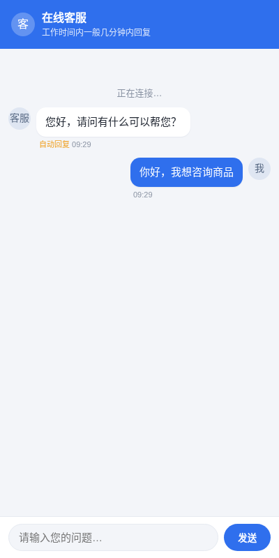
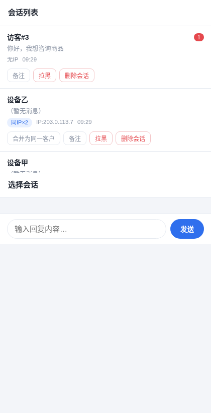
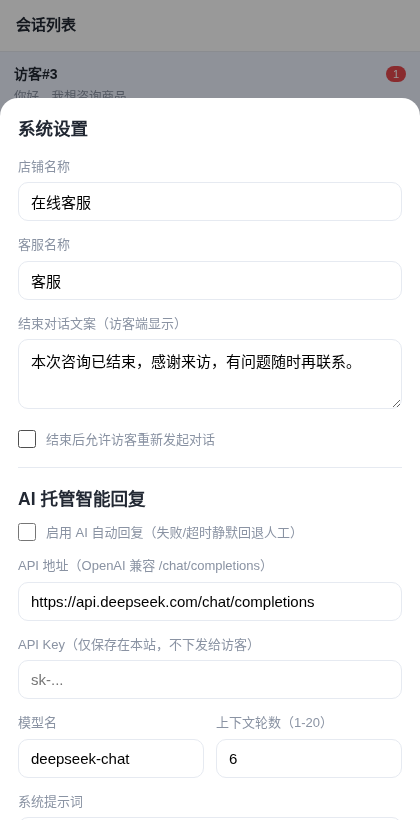

# 在线客服聊天系统（Cloudflare Workers + D1）

访客端和客服工作台在同一个域名下，纯 Cloudflare 免费额度即可运行：**Workers（计算）+ D1（数据库）+ 静态资源**。图片默认存 D1，配置 R2 后自动改用 R2，全程无需服务器、无需付费。

## 功能（v3.4）

**访客端 `/`**
- 打开网址直接对话，无需注册登录；身份存在浏览器本地，刷新不丢记录
- 发文字、表情、图片（前端自动压缩后上传），支持撤回、单侧删除、已读 / 未读回执
- 命中关键词自动收到回复（带「自动回复」标签），可留下联系方式（手机 / 微信 / QQ / 邮箱）
- 收到「视频 / 语音」链接卡片，点击新标签打开；对话被客服结束后显示结束文案、输入框禁用

**客服工作台 `/agent.html`**
- 口令登录，可自定义客服名称；多客服可同时登录，消息按各自名称署名
- 会话列表：按最新消息排序、未读角标、在线状态、访客 IP / 归属地 / 来源网站 / 设备识别
- 收发回复、撤回、备注、拉黑（可撤销）、删除会话（二次确认）、导出单个会话 CSV
- **同客户归并**：同一客户换浏览器、换设备再来（出口 IP 相同）自动标「同IP×N」，一键合并为同一客户组，随时可拆分，不删消息、不删会话
- **AI 托管**：接入任意 OpenAI 兼容大模型（默认 DeepSeek）自动回复，8 秒超时静默回退人工；AI 回复带「AI」标签，不响铃、不推送，Key 只存在你自己的 D1，不下发访客
- **结束对话 / 重新打开**：结束后访客端输入框变灰，客服不再响铃、不推送、不触发 AI；可配置结束后允许客户重新发起
- **视频 / 语音链接面板**：发送腾讯会议、微信视频、电话、二维码等外部链接卡片
- 在线 / 离线两套关键词自动回复；Server酱 / PushPlus / 钉钉 / 企微 / Bark 五渠道消息推送；三音提示音可重复、可上传自定义；客服头像上传；店铺名 / 欢迎语自定义

**网站嵌入**
- `public/embed.js`：一行代码在你的网站右下角出现悬浮客服按钮，点击打开聊天窗口

## 预览





## 快速部署（Fork，全程浏览器操作，无需命令行）

完整图文步骤见《[Cloudflare部署完整教程.md](Cloudflare部署完整教程.md)》，流程一句话：

1. 右上角 **Fork** 本项目到你自己的 GitHub 账号；
2. Cloudflare 控制台创建免费 D1 数据库 `cf_kefu`，复制 Database ID；
3. 在自己 Fork 的仓库里打开 `wrangler.toml`，把 `REPLACE_WITH_YOUR_D1_DATABASE_ID` 替换成你的 ID 并提交；
4. Cloudflare Workers Builds 连接你 Fork 的仓库并自动部署；
5. 打开 `/agent.html`，首次登录输入的口令即成为系统口令，请牢记。

> 数据表由 Worker 首次运行时自动创建、自动补列，不需要手工执行 SQL。

## 目录结构

```
cf-kefu-chat/
├── src/index.js                 # Worker：API + 路由 + 自动建表 / 补列
├── public/
│   ├── index.html               # 访客端
│   ├── agent.html                # 客服工作台（登录 / 列表 / 设置）
│   ├── embed.js                 # 网站悬浮挂件
│   └── assets/
│       ├── app.css               # 两端共用样式
│       └── chat.js               # 两端共用聊天核心
├── migrations/                  # 建表 SQL（仅参考，运行时自动建表）
├── wrangler.toml                # Cloudflare 配置（只填 database_id）
├── 预览/                         # 界面截图
└── docs/reward/                 # 赞赏码
```

## 说明与限制

- **实时性**：轮询方案，访客可见时秒级同步；按 Workers 免费额度可满足中小店铺常开接待。
- **图片存储**：未配置 R2 时存 D1（前端压到 400KB 内）；更大图片可取消 `wrangler.toml` 里 `[[r2_buckets]]` 的注释并建 R2 桶。
- **视频通话**：免费 Workers 无法承载 WebRTC，「视频 / 语音」是外部会议链接入口，不是平台内面对面视频通话。
- **数据**：全部存在你自己的 D1 里，可在 Cloudflare 控制台直接查询。

## 版本与更新日志

- 当前版本：**v3.4（2026-11-23）**
- 完整版本记录见 [CHANGELOG.md](CHANGELOG.md)
- 旧版升级见 [升级说明.md](升级说明.md)
- 判断线上版本：访问 `/api/health`，查看 `version` 字段

## 赞助与支持

本项目由个人独立开发与维护，代码、文档与部署教程全部免费开放，**无功能限制、无使用期限，也不存在付费版本**。

如果这套系统为您的店铺经营或日常工作带来了实际帮助，欢迎通过下方二维码自愿赞赏，用以覆盖服务器、数据库等成本，并支持作者持续维护、开发新功能与完善文档。金额不限，完全自愿，且不影响您使用本项目的任何权利。

<table>
  <tr>
    <td align="center" width="230">
      <br>
      <sub>微信赞赏</sub>
    </td>
    <td align="center" width="230">
      <br>
      <sub>支付宝赞赏</sub>
    </td>
  </tr>
</table>

**几点说明**

- 赞赏完全自愿，不构成购买服务、购买授权或投资，不产生任何服务义务；
- 不提供发票，不承诺定制开发、功能排期或优先技术支持；
- 项目按现有节奏维护，赞赏与否不影响使用与问题反馈；
- 如需商业授权、定制开发或长期技术支持，请另行沟通约定。

感谢您的信任与支持，祝您客源广进、生意兴隆。

<sub>English: This project is developed and maintained independently and released free of charge, with no feature limits and no paid tier. If it is useful to you, a voluntary contribution is welcome and helps cover hosting and maintenance costs. A contribution is not a purchase of services or a license and creates no service obligation; no invoices, custom development or priority support are provided.</sub>
