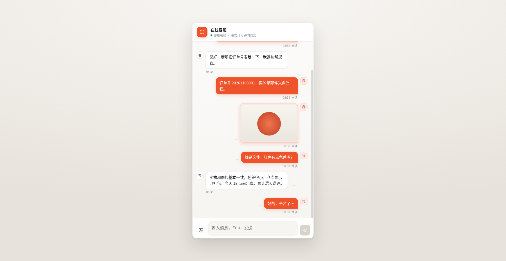
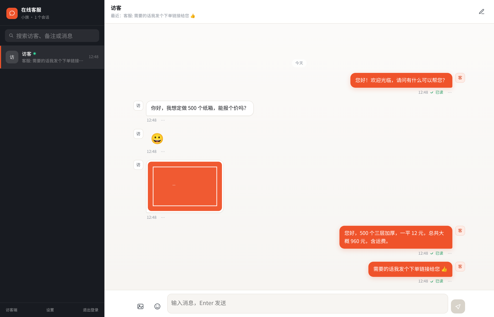

# 在线客服聊天系统（Workers + D1）

访客端和客服工作台在同一个域名下，纯 Cloudflare 免费额度就能跑：**Workers（计算）+ D1（数据库）+ 静态资源**。图片默认也存 D1，配置 R2 后自动改用 R2。




## 功能

**访客端 `/`**
- 打开网址直接对话，不需要注册登录（身份存在浏览器本地，刷新不丢记录）
- 文字、表情（内置表情面板）、图片（自动压缩后上传）
- 撤回（默认 120 秒内，仅发送方可撤回，双方都显示撤回提示）
- 删除（只对自己隐藏，对方不受影响）
- 自己发的消息显示 **已读 / 未读**
- 图片点击可全屏查看

**客服工作台 `/agent`**
- 口令登录，可自定义客服名称（首次登录时输入的口令即成为系统口令）
- 会话列表：按最新消息排序，显示最后一条预览、**未读角标**、对方**在线**小绿点
- 备注顾客（只在自己工作台显示，不影响访客端）
- 文字 / 表情 / 图片，同样支持撤回、删除、已读回执
- 设置面板：店铺名称、客服名称、自动欢迎语（开关 + 内容 + 署名）、修改口令
- 窄屏自动切换「会话列表 → 聊天」单栏布局

## 目录结构

```
cf-kefu-chat/
├── src/index.js                   # Worker：API + 静态资源路由 + 自动建表
├── public/
│   ├── index.html                 # 访客端
│   ├── agent.html                 # 客服工作台（登录/设置/备注）
│   ├── favicon.svg
│   └── assets/
│       ├── app.css                # 两端共用样式
│       └── chat.js                # 两端共用聊天核心（轮询/表情/图片/撤回/已读）
├── migrations/                    # 建表 SQL（仅参考，运行时会自动建表）
├── wrangler.toml                  # Cloudflare 配置
├── .github/workflows/deploy.yml   # 可选：GitHub Actions 部署
└── docs/                          # 预览截图
```

## 部署（不需要任何命令行）

1. **建 D1 数据库**：Cloudflare 控制台 → Storage & Databases → D1 SQL Database → Create database，名称 `cf_kefu`，创建后复制 `Database ID`。
2. **传代码到 GitHub**：新建仓库，把本项目所有文件（保持目录结构）上传提交。
3. **填 database_id**：在 GitHub 打开 `wrangler.toml`，把 `REPLACE_WITH_YOUR_D1_DATABASE_ID` 替换成第 1 步的 ID，提交。
4. **连自动部署**：Cloudflare 控制台 → Workers & Pages → Create → Workers → Import a repository → 选这个仓库；构建命令 `npm install`，部署命令 `npx wrangler deploy` → 部署。
5. 打开输出的 `https://cf-kefu-chat.xxx.workers.dev`（访客端），`/agent` 是客服端。**第一次登录时输入的口令会自动成为系统口令。**

> 数据表由 Worker 首次请求时自动创建，不需要执行 `wrangler d1 migrations apply`。

## 改配置

`wrangler.toml` 的 `[vars]` 只是**初始默认值**，部署后都能在「工作台 → 设置」里改并立即生效：

| 变量 | 说明 |
| --- | --- |
| `SHOP_NAME` | 访客端顶部店铺名（首次建库时写入 D1，之后以设置为准） |
| `AGENT_NAME` | 欢迎语默认署名 |
| `WELCOME_MESSAGE` | 默认欢迎语内容 |
| `MAX_IMAGE_MB` | 单张图片上限（默认 5） |
| `RECALL_WINDOW_SEC` | 撤回时限秒数（默认 120） |

前端刷新频率：`public/assets/chat.js` 顶部 `POLL_VISIBLE = 2000`（页面可见时）、`POLL_HIDDEN = 8000`（切到后台时降频）。

## 接口

| 方法 | 路径 | 说明 |
| --- | --- | --- |
| POST | `/api/session` | 访客建会话（新会话自动发欢迎语） |
| POST | `/api/login` | 客服登录（名称 + 口令） |
| GET | `/api/me` | 当前客服信息 |
| POST | `/api/agent/profile` | 改客服名称 |
| GET/POST | `/api/settings` | 读取 / 保存店铺名、欢迎语、口令 |
| GET | `/api/conversations` | 会话列表（未读、在线、备注） |
| POST | `/api/conversations/:id/remark` | 备注顾客 |
| GET | `/api/messages?conv=&after=&since=` | 拉消息：`after` 增量，`since` 状态变化 |
| POST | `/api/messages` | 发消息（text / image） |
| POST | `/api/messages/:id/recall` | 撤回 |
| POST | `/api/messages/:id/delete` | 删除（单侧隐藏） |
| POST | `/api/upload?conv=` | 上传图片 |
| GET | `/api/file/:key` | 读图片 |
| POST | `/api/read` | 标记已读 |

鉴权：访客用请求头 `x-visitor-token`；客服 `Authorization: Bearer <登录返回的 token>`。

## 说明与限制

- **实时性**：轮询方案，可见时 2 秒、后台时 8 秒。按 Workers 每天 10 万次请求额度，足够 2～3 个客服台常开 + 若干访客在线。需要真推送可后续换 Durable Objects + WebSocket。
- **图片存储**：未配置 R2 时存 D1（单张 ≤ 700KB，前端会自动压到 400KB 内）；要发更大的图就取消 `wrangler.toml` 里 `[[r2_buckets]]` 的注释并建一个 R2 桶。
- **客服账号**：目前是「共享口令 + 自定义名称」，多客服可同时登录，消息按各自名称署名。
- **数据**：都在你的 D1 里，可在控制台用 SQL 直接查。

## 已验证

本地用 node:sqlite 模拟 D1 + Chromium 跑了完整回归：55 项接口断言（建会话、欢迎语、登录首设口令、错误口令、未读计数、已读回写、增量同步、撤回权限与超时、单侧删除、图片上传读回、备注、改名、设置、越权拦截、超长/空消息）与 37 项浏览器交互用例（文字/表情/图片发送、双端 2 秒内同步、已读回执、撤回提示、删除单侧生效、备注、设置保存、手机端布局、刷新保持登录）全部通过。
